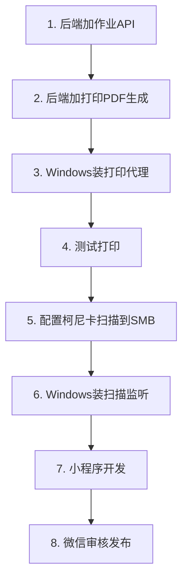

# 叙阅微信小程序 — 打印作业 + 扫描批改 技术方案

> 版本：v1.0 | 日期：2026-09-08 | 适用：柯尼卡美能达 / 理光 网络复合机

---

## 目录

1. [整体架构](#1-整体架构)
2. [打印机型号与规格](#2-打印机型号与规格)
3. [环境准备](#3-环境准备)
4. [Windows 打印代理（核心组件）](#4-windows-打印代理核心组件)
5. [柯尼卡美能达扫描配置](#5-柯尼卡美能达扫描配置)
6. [后端 API 设计](#6-后端-api-设计)
7. [微信小程序端](#7-微信小程序端)
8. [部署与运维](#8-部署与运维)
9. [故障排查](#9-故障排查)
10. [附录](#10-附录)

---

## 1. 整体架构

```
┌─────────────────────────────────────────────────────────────────────┐
│                        微信小程序（老师端）                           │
│  ┌──────────────┐  ┌──────────────┐  ┌──────────────┐             │
│  │ 布置作业      │  │ 一键打印      │  │ 查看批改报告  │             │
│  └──────┬───────┘  └──────┬───────┘  └──────┬───────┘             │
└─────────┼─────────────────┼──────────────────┼─────────────────────┘
          │  HTTPS           │  HTTPS           │  HTTPS
          ▼                  ▼                  ▼
┌─────────────────────────────────────────────────────────────────────┐
│              后端服务器 xuyue.6108.net (120.26.101.0)                │
│                                                                     │
│  ┌─────────────────────────────────────────────────────────────────┐ │
│  │  FastAPI 后端 (端口 6888)                                       │ │
│  │                                                                 │ │
│  │  POST /api/v1/assignments/create     → 创建作业，生成 PDF       │ │
│  │  POST /api/v1/print-proxy/send       → 推送 PDF 到打印代理      │ │
│  │  POST /api/v1/scan-jobs/notify       → 扫描文件通知批改         │ │
│  │  GET  /api/v1/assignments/{id}/report → 获取批改报告            │ │
│  └─────────────────────────────────────────────────────────────────┘ │
└─────────┬──────────────────────────────────┬─────────────────────────┘
          │ 内网穿透 / VPN / 公网              │
          ▼                                   ▼
┌─────────────────────────┐    ┌──────────────────────────────────┐
│  Windows 打印代理        │    │  柯尼卡扫描监听服务               │
│  (本机 D:\job2)          │    │  (本机 D:\job2)                  │
│                          │    │                                  │
│  Flask 端口 5001         │    │  Watchdog 监听 D:\scan_jobs\    │
│  接收 PDF → win32print   │    │  新文件 → 推给后端 AI 批改       │
│  → 打印机出纸             │    │                                  │
└───────────┬──────────────┘    └──────────────┬───────────────────┘
            │                                   │
            ▼                                   ▲
┌───────────────────────┐      ┌──────────────────────────────┐
│  柯尼卡美能达 bizhub  │      │  柯尼卡美能达 bizhub 扫描     │
│  (打印作业纸)          │      │  (学生做完→扫描进 SMB 共享)   │
└───────────────────────┘      └──────────────────────────────┘
```

### 1.1 数据流详解

#### 打印流程（小程序 → 打印机）
```
① 老师在小程序选模板 → 点「布置并打印」
② 小程序调 POST /api/v1/assignments/create
③ 后端生成 PDF（reportlab/pyton-pptx）
④ 后端将 PDF 返回给小程序（或直接推给打印代理）
⑤ 小程序 / 后端 将 PDF 转发到 Windows 打印代理 :5001
⑥ 打印代理接收 → win32print → 柯尼卡/理光 → 出纸
⑦ 小程序提示「打印成功」
```

#### 批改流程（扫描 → 报告）
```
① 学生做完作业 → 老师收回作业纸
② 老师把作业纸放进柯尼卡 ADF 自动进稿器
③ 柯尼卡扫描到 SMB 共享文件夹 D:\scan_jobs\
④ 扫描监听服务检测到新文件（watchdog）
⑤ 监听服务调 POST /api/v1/scan-jobs/notify 推给后端
⑥ 后端 AI 批改引擎（百度 correct_edu / DeepSeek）出结果
⑦ 小程序拉 GET /api/v1/assignments/{id}/report 展示报告
```

---

## 2. 打印机型号与规格

### 2.1 柯尼卡美能达 bizhub 系列

| 项目 | 规格 |
|------|------|
| 打印协议 | IPP, Raw 9100, LPR, AirPrint, Mopria |
| 扫描协议 | **SMB（推荐）**, FTP, Email, WebDAV |
| 有线网络 | RJ45 1000Base-T |
| 无线网络 | 需选配 WiFi 套件（WK-511） |
| 蓝牙 | ❌ **不支持** |
| USB 直连 | ✅ 但只能连电脑，不能连手机 |
| ADF 自动进稿 | ✅ 标配（双面扫描） |
| 扫描速度 | 60-80 ppm（页/分钟） |
| 支持格式 | PDF, TIFF, JPEG, 压缩PDF |

### 2.2 理光 IM C3500

| 项目 | 规格 |
|------|------|
| 打印协议 | IPP, Raw 9100, LPR, AirPrint, Mopria |
| 扫描协议 | SMB, FTP, Email |
| 网络 | RJ45 + 内置 WiFi |
| 蓝牙 | ❌ **不支持** |
| ADF | ✅ 标配 |
| 扫描速度 | 60 ppm |

### 2.3 打印协议对比

| 协议 | 端口 | 是否需要PC | 适用于 |
|------|------|-----------|--------|
| **Raw 9100** | TCP 9100 | ✅ 需要 PC 发指令 | 后端 → 打印 |
| **IPP** | TCP 631 | ✅ 需要 PC/服务器 | 后端 → 打印 |
| **LPR** | TCP 515 | ✅ 需要 PC/服务器 | 后端 → 打印 |
| **AirPrint** | 局域网 | ❌ 手机直连（iPhone） | 老师自己手机打印 |
| **Mopria** | 局域网 | ❌ Android 直连 | 老师自己手机打印 |
| **蓝牙** | — | — | ❌ 不支持 |

> **结论：小程序无法直连打印机。必须通过 PC 中转打印。**

---

## 3. 环境准备

### 3.1 硬件要求

| 设备 | 数量 | 说明 |
|------|------|------|
| 柯尼卡/理光打印机 | 1 | 放在学校办公室 |
| Windows 电脑（本机） | 1 | 已装打印机驱动，可正常打印 |
| 路由器/交换机 | 1 | 打印机和电脑在同一局域网 |
| 云服务器 | 1 | 已部署 xuyue.6108.net |

### 3.2 软件要求

#### Windows 本机
- Python 3.11+（已有 `D:\anconda\python.exe`）
- 打印机驱动已装（Windows 能正常打印）
- 本机能访问 `xuyue.6108.net`（HTTPS 出站）

#### 云服务器
- 现有叙阅后端（FastAPI 6888）
- 安装 `reportlab` / `python-pptx`（已有）
- 内网穿透客户端（可选，见 8.3）

### 3.3 网络拓扑

```
        公网                         学校内网
┌─────────────────┐          ┌──────────────────────────┐
│  阿里云 ECS      │          │  路由器 (192.168.1.x)     │
│  120.26.101.0   │  HTTPS   │       │           │       │
│  xuyue.6108.net │◄─────────┤       │           │       │
│                 │          │  ┌────┴────┐ ┌───┴────┐  │
│  后端 :6888     │          │  │ 本机Win  │ │ 打印机  │  │
│  打印代理(可选)  │          │  │ 192.168  │ │ .1.100  │  │
└─────────────────┘          │  │ .1.10    │ │         │  │
                             │  └─────────┘ └─────────┘  │
                             └──────────────────────────┘
```

> **关键：如果云服务器无法直接访问内网打印机，打印代理必须跑在本机（Windows），由本机向打印机发 Raw 9100 或 win32print。**

---

## 4. Windows 打印代理（核心组件）

### 4.1 功能概述

运行在 Windows 本机上的 HTTP 服务，接收 PDF 并调用 win32print 发送到打印机。

### 4.2 完整代码

```python
"""
print_proxy.py — 叙阅 Windows 打印代理
用途：接收 PDF → win32print → 发送到本地打印机
运行：python print_proxy.py
依赖：pip install flask pywin32
"""

import os
import sys
import json
import tempfile
import logging
import uuid
from datetime import datetime
from pathlib import Path

from flask import Flask, request, jsonify, send_file

# ─── 配置 ─────────────────────────────────────────────────
HOST = '0.0.0.0'           # 监听所有网卡（内网可访问）
PORT = 5001                 # 打印代理端口
PRINTER_NAME = None         # None = 使用系统默认打印机
LOG_DIR = r'D:\job2\print_proxy_logs'   # 打印日志目录
TEMP_DIR = r'D:\job2\print_proxy_temp'  # 临时文件目录
ALLOWED_TOKENS = ['your-secret-token-here']  # 简单鉴权

# ─── 日志设置 ─────────────────────────────────────────────
os.makedirs(LOG_DIR, exist_ok=True)
os.makedirs(TEMP_DIR, exist_ok=True)

logging.basicConfig(
    level=logging.INFO,
    format='%(asctime)s [%(levelname)s] %(message)s',
    handlers=[
        logging.FileHandler(os.path.join(LOG_DIR, 'print_proxy.log'), encoding='utf-8'),
        logging.StreamHandler()
    ]
)
logger = logging.getLogger('print_proxy')

app = Flask(__name__)


# ─── 工具函数 ─────────────────────────────────────────────

def get_printers():
    """获取本机所有打印机列表"""
    import win32print
    printers = []
    for p in win32print.EnumPrinters(2):
        printers.append({
            'name': p[2],
            'driver': p[1],
            'port': p[3],
            'status': p[4],
            'is_default': False,
        })
    # 标记默认打印机
    try:
        default = win32print.GetDefaultPrinter()
        for p in printers:
            if p['name'] == default:
                p['is_default'] = True
    except:
        pass
    return printers


def get_effective_printer():
    """获取实际使用的打印机名称"""
    import win32print
    if PRINTER_NAME:
        return PRINTER_NAME
    return win32print.GetDefaultPrinter()


def print_pdf(pdf_data: bytes, job_name: str = None) -> dict:
    """
    核心打印函数
    将 PDF 字节数据发送到 Windows 打印机
    
    参数:
        pdf_data: PDF 文件二进制内容
        job_name: 打印任务名称（显示在打印机队列中）
    
    返回:
        {'success': True/False, 'job_id': ..., 'error': ...}
    """
    import win32print
    import win32api
    
    printer_name = get_effective_printer()
    job_name = job_name or f'叙阅作业_{datetime.now().strftime("%Y%m%d_%H%M%S")}'
    
    # 保存临时 PDF 文件
    tmp_file = tempfile.NamedTemporaryFile(
        dir=TEMP_DIR,
        delete=False,
        suffix='.pdf',
        prefix='xuyue_print_'
    )
    tmp_path = tmp_file.name
    try:
        tmp_file.write(pdf_data)
        tmp_file.close()
        
        logger.info(f'发送打印任务: printer={printer_name}, file={tmp_path}, job={job_name}')
        
        # 调用 ShellExecute 打印（使用默认关联程序打开后打印）
        # 注意：ShellExecute 的 "print" 命令会启动关联程序（如 Adobe Reader）并发送打印指令
        win32api.ShellExecute(
            0,                          # 父窗口句柄
            "print",                    # 操作：print
            tmp_path,                   # 文件路径
            f'/d:"{printer_name}"',     # 打印机设备名
            ".",                        # 工作目录
            0                           # 不显示窗口
        )
        
        # 记录打印日志
        log_entry = {
            'timestamp': datetime.now().isoformat(),
            'printer': printer_name,
            'job_name': job_name,
            'file': tmp_path,
            'size_bytes': len(pdf_data),
            'status': 'sent'
        }
        with open(os.path.join(LOG_DIR, 'print_history.jsonl'), 'a', encoding='utf-8') as f:
            f.write(json.dumps(log_entry, ensure_ascii=False) + '\n')
        
        return {'success': True, 'printer': printer_name, 'job_name': job_name}
        
    except Exception as e:
        logger.error(f'打印失败: {e}')
        return {'success': False, 'error': str(e)}
        
    finally:
        # 清理临时文件（延迟 5 秒，确保打印任务已提交）
        import threading
        def cleanup():
            import time
            time.sleep(5)
            try:
                if os.path.exists(tmp_path):
                    os.unlink(tmp_path)
            except:
                pass
        threading.Thread(target=cleanup, daemon=True).start()


# ─── API 路由 ─────────────────────────────────────────────

@app.route('/health', methods=['GET'])
def health():
    """健康检查"""
    return jsonify({
        'status': 'ok',
        'printer': get_effective_printer(),
        'printers': get_printers(),
        'time': datetime.now().isoformat()
    })


@app.route('/printers', methods=['GET'])
def list_printers():
    """列出本机所有打印机"""
    return jsonify({
        'printers': get_printers(),
        'default': get_effective_printer()
    })


@app.route('/print', methods=['POST'])
def print_job():
    """
    接收 PDF 并打印
    请求体：原始 PDF 二进制（Content-Type: application/pdf）
    或 JSON：{"pdf_url": "https://...", "job_name": "..."}
    """
    # 简单鉴权
    token = request.headers.get('X-Auth-Token', '')
    if ALLOWED_TOKENS and token not in ALLOWED_TOKENS:
        return jsonify({'error': '未授权'}), 401
    
    job_name = request.headers.get('X-Job-Name', None)
    content_type = request.content_type or ''
    
    try:
        if 'application/pdf' in content_type:
            # 直接接收 PDF 二进制
            pdf_data = request.get_data()
            if not pdf_data:
                return jsonify({'error': 'PDF 数据为空'}), 400
            
            result = print_pdf(pdf_data, job_name)
            
        elif 'application/json' in content_type:
            # 接收 JSON：从 URL 下载 PDF 再打印
            data = request.get_json()
            pdf_url = data.get('pdf_url')
            if not pdf_url:
                return jsonify({'error': '缺少 pdf_url'}), 400
            
            import urllib.request
            with urllib.request.urlopen(pdf_url) as resp:
                pdf_data = resp.read()
            
            result = print_pdf(pdf_data, data.get('job_name', job_name))
            
        else:
            return jsonify({'error': f'不支持的 Content-Type: {content_type}'}), 400
        
        if result['success']:
            return jsonify(result), 200
        else:
            return jsonify(result), 500
            
    except Exception as e:
        logger.exception('打印请求处理失败')
        return jsonify({'error': str(e)}), 500


@app.route('/print/settings', methods=['GET', 'POST'])
def printer_settings():
    """查看/设置默认打印机"""
    if request.method == 'POST':
        data = request.get_json()
        new_printer = data.get('printer_name')
        printers = [p['name'] for p in get_printers()]
        
        if new_printer not in printers:
            return jsonify({
                'error': f'打印机 "{new_printer}" 不存在',
                'available': printers
            }), 400
        
        # 写入配置（下次启动生效）
        config_path = os.path.join(LOG_DIR, 'printer_config.json')
        with open(config_path, 'w', encoding='utf-8') as f:
            json.dump({'printer_name': new_printer}, f)
        
        # 本次运行时也生效
        global PRINTER_NAME
        PRINTER_NAME = new_printer
        
        return jsonify({'ok': True, 'printer': new_printer})
    
    # GET：返回当前设置
    return jsonify({
        'current_printer': get_effective_printer(),
        'all_printers': get_printers()
    })


@app.route('/print/history', methods=['GET'])
def print_history():
    """查看打印历史"""
    history_path = os.path.join(LOG_DIR, 'print_history.jsonl')
    if not os.path.exists(history_path):
        return jsonify({'history': []})
    
    limit = request.args.get('limit', 50, type=int)
    records = []
    with open(history_path, 'r', encoding='utf-8') as f:
        for line in f:
            if line.strip():
                records.append(json.loads(line))
    
    return jsonify({'history': records[-limit:]})


# ─── 启动 ─────────────────────────────────────────────────

if __name__ == '__main__':
    # 启动时打印本机打印机列表
    import win32print
    print('=' * 60)
    print('叙阅 Windows 打印代理')
    print('=' * 60)
    print(f'\n本机打印机列表:')
    for p in get_printers():
        default_mark = ' ← 默认' if p['is_default'] else ''
        print(f'  - {p["name"]}{default_mark}')
    
    print(f'\n当前使用: {get_effective_printer()}')
    print(f'启动地址: http://{HOST}:{PORT}')
    print(f'健康检查: http://localhost:{PORT}/health')
    print(f'打印接口: POST http://localhost:{PORT}/print')
    print(f'日志目录: {LOG_DIR}')
    print('=' * 60)
    
    # 从配置文件读取打印机设置（如果有）
    config_path = os.path.join(LOG_DIR, 'printer_config.json')
    if os.path.exists(config_path):
        try:
            with open(config_path, 'r', encoding='utf-8') as f:
                cfg = json.load(f)
            if cfg.get('printer_name'):
                global PRINTER_NAME
                PRINTER_NAME = cfg['printer_name']
                print(f'已加载配置: 打印机 = {PRINTER_NAME}')
        except:
            pass
    
    app.run(host=HOST, port=PORT, debug=False)
```

### 4.3 安装与启动

```bash
# 1. 安装依赖
pip install flask pywin32

# 2. 测试打印机是否正常
python -c "import win32print; print(win32print.GetDefaultPrinter())"

# 3. 启动打印代理
python D:\job2\print_proxy.py

# 4. 验证启动
curl http://localhost:5001/health
```

### 4.4 注册为 Windows 服务（开机自启）

```batch
:: 方法一：使用 nssm 注册为 Windows 服务
:: 下载 nssm: https://nssm.cc/download
nssm install 叙阅打印代理 "D:\anconda\python.exe" "D:\job2\print_proxy.py"
nssm start 叙阅打印代理

:: 方法二：使用任务计划程序（推荐）
:: 1. 打开「任务计划程序」
:: 2. 创建任务 → 触发器「计算机启动时」
:: 3. 操作「启动程序」→ python D:\job2\print_proxy.py
```

### 4.5 从后端调用打印代理

```python
# 后端代码中调用打印代理的示例
import requests

def send_to_print_proxy(pdf_data: bytes, job_name: str = None):
    """
    将 PDF 发送到 Windows 打印代理
    
    参数:
        pdf_data: PDF 二进制数据
        job_name: 作业名称（可选）
    """
    # 打印代理地址（需要内网穿透或 VPN）
    # 如果打印代理在本机局域网，用内网 IP
    # 如果打印代理通过 frp 暴露到公网，用公网地址
    proxy_url = "http://192.168.1.10:5001/print"  # 或公网映射地址
    
    headers = {
        'Content-Type': 'application/pdf',
        'X-Auth-Token': 'your-secret-token-here',
    }
    if job_name:
        headers['X-Job-Name'] = job_name
    
    resp = requests.post(proxy_url, data=pdf_data, headers=headers, timeout=60)
    return resp.json()
```

---

## 5. 柯尼卡美能达扫描配置

### 5.1 扫描到 SMB 共享文件夹

#### 步骤 1：Windows 本机创建共享文件夹

```batch
:: 创建扫描接收目录
mkdir D:\scan_jobs

:: 设置共享（管理员 PowerShell）
New-SmbShare -Name "scan_jobs" -Path "D:\scan_jobs" -FullAccess "Everyone"
```

或在 Windows 上：
1. 右键 `D:\scan_jobs` → **属性 → 共享 → 高级共享**
2. 勾选 **共享此文件夹**
3. 权限：**Everyone** 读取/写入
4. 记下本机 IP（`ipconfig` 查看 IPv4 地址）

#### 步骤 2：柯尼卡面板上配置扫描目的地

```
打印机面板操作路径：
[主菜单] → [扫描] → [通讯簿] → [注册目的地]
    → [SMB]
    → 名称：叙阅扫描
    → 主机名：192.168.1.10    （← Windows 本机的内网 IP）
    → 文件路径：scan_jobs      （← 共享文件夹名称）
    → 用户名：guest            （或 Windows 登录用户名）
    → 密码：****               （Windows 登录密码）
    → 保存
```

#### 步骤 3：设置扫描参数

```
[扫描设置] → [原稿类型] → [双面扫描]（如果双面打印）
[扫描设置] → [分辨率] → 200 dpi（平衡速度和清晰度）
[扫描设置] → [文件格式] → PDF（多页合并）或 JPEG（逐页）
[扫描设置] → [色彩] → 全彩 或 灰度
[扫描设置] → [文件名] → 自动生成（含日期时间）
```

#### 步骤 4：测试扫描

1. 放一张纸到 ADF 自动进稿器
2. 按 **扫描 → 选择「叙阅扫描」→ 启动**
3. 检查 `D:\scan_jobs\` 是否收到文件

### 5.2 扫描监听服务

```python
"""
scan_watcher.py — 叙阅扫描监听服务
用途：监听 D:\scan_jobs\ 新文件 → 推给后端批改
运行：python scan_watcher.py
依赖：pip install watchdog requests
"""

import os
import sys
import json
import time
import logging
import hashlib
from datetime import datetime
from pathlib import Path

import requests
from watchdog.observers import Observer
from watchdog.events import FileSystemEventHandler

# ─── 配置 ─────────────────────────────────────────────────
SCAN_DIR = r'D:\scan_jobs'           # 扫描文件目录
ARCHIVE_DIR = r'D:\scan_jobs\archive'  # 已处理文件归档
API_BASE = 'https://xuyue.6108.net/api/v1'  # 后端 API 地址
API_KEY = 'your-backend-api-key'      # 后端鉴权
POLL_INTERVAL = 5                     # 文件稳定等待时间（秒）

# ─── 日志 ─────────────────────────────────────────────────
os.makedirs(SCAN_DIR, exist_ok=True)
os.makedirs(ARCHIVE_DIR, exist_ok=True)

logging.basicConfig(
    level=logging.INFO,
    format='%(asctime)s [%(levelname)s] %(message)s',
    handlers=[
        logging.FileHandler(os.path.join(SCAN_DIR, 'scan_watcher.log'), encoding='utf-8'),
        logging.StreamHandler()
    ]
)
logger = logging.getLogger('scan_watcher')


class ScanHandler(FileSystemEventHandler):
    """扫描文件事件处理器"""
    
    def __init__(self):
        self._processing = set()  # 正在处理中的文件，避免重复触发
    
    def on_created(self, event):
        """新文件创建时触发"""
        if event.is_directory:
            return
        
        file_path = event.src_path
        ext = os.path.splitext(file_path)[1].lower()
        
        # 只处理 PDF 和图片文件
        if ext not in ('.pdf', '.jpg', '.jpeg', '.png', '.tiff', '.tif'):
            return
        
        # 文件名去重保护
        file_key = os.path.basename(file_path)
        if file_key in self._processing:
            return
        
        self._processing.add(file_key)
        try:
            # 等待文件写入完成
            self._wait_for_file_stable(file_path)
            
            # 处理文件
            self._process_file(file_path)
        finally:
            self._processing.discard(file_key)
    
    def _wait_for_file_stable(self, file_path, timeout=30):
        """等待文件写入完成（文件大小不再变化）"""
        logger.info(f'等待文件稳定: {file_path}')
        start = time.time()
        last_size = -1
        
        while time.time() - start < timeout:
            if not os.path.exists(file_path):
                time.sleep(1)
                continue
            
            current_size = os.path.getsize(file_path)
            if current_size == last_size and current_size > 0:
                time.sleep(POLL_INTERVAL)  # 额外等待确保写入完成
                return True
            
            last_size = current_size
            time.sleep(1)
        
        logger.warning(f'文件超时未稳定: {file_path}')
        return False
    
    def _process_file(self, file_path):
        """处理单个扫描文件"""
        logger.info(f'处理扫描文件: {file_path}')
        
        try:
            # 计算文件哈希（用于去重）
            file_hash = self._hash_file(file_path)
            file_size = os.path.getsize(file_path)
            file_name = os.path.basename(file_path)
            
            # 读取文件内容
            with open(file_path, 'rb') as f:
                file_data = f.read()
            
            # 推送后端
            # 方式一：直接上传文件（推荐）
            self._upload_to_backend(file_data, file_name, file_hash)
            
            # 方式二：先通知后端，后端再拉取
            # self._notify_backend(file_name, file_hash, file_size)
            
            # 归档已处理文件
            archive_path = os.path.join(ARCHIVE_DIR, file_name)
            # 如果文件已存在，加时间戳后缀
            if os.path.exists(archive_path):
                base, ext = os.path.splitext(file_name)
                archive_path = os.path.join(
                    ARCHIVE_DIR,
                    f"{base}_{datetime.now().strftime('%Y%m%d%H%M%S')}{ext}"
                )
            os.rename(file_path, archive_path)
            logger.info(f'文件已归档: {archive_path}')
            
        except Exception as e:
            logger.exception(f'文件处理失败: {file_path}')
            # 失败文件移到 error 子目录
            error_dir = os.path.join(SCAN_DIR, 'error')
            os.makedirs(error_dir, exist_ok=True)
            try:
                os.rename(file_path, os.path.join(error_dir, os.path.basename(file_path)))
            except:
                pass
    
    def _hash_file(self, file_path):
        """计算文件 MD5"""
        h = hashlib.md5()
        with open(file_path, 'rb') as f:
            for chunk in iter(lambda: f.read(65536), b''):
                h.update(chunk)
        return h.hexdigest()
    
    def _upload_to_backend(self, file_data, file_name, file_hash):
        """上传文件到后端批改接口"""
        url = f"{API_BASE}/scan-jobs/upload"
        
        # 模拟 multipart/form-data 上传
        boundary = '----WebKitFormBoundary' + hashlib.md5(str(time.time()).encode()).hexdigest()[:16]
        body = []
        body.append(f'--{boundary}'.encode())
        body.append(b'Content-Disposition: form-data; name="file"; filename="' + file_name.encode() + b'"')
        body.append(b'Content-Type: application/octet-stream')
        body.append(b'')
        body.append(file_data)
        body.append(f'--{boundary}--'.encode())
        
        # 形参：按实际后端接口调整
        params = {
            'file_hash': file_hash,
            'source': 'scan_watcher',
        }
        
        headers = {
            'Content-Type': f'multipart/form-data; boundary={boundary}',
            'X-API-Key': API_KEY,
        }
        
        resp = requests.post(
            url,
            data=b'\r\n'.join(body),
            headers=headers,
            params=params,
            timeout=120  # 超大文件上传需要较长时间
        )
        
        logger.info(f'上传结果: status={resp.status_code}, body={resp.text[:200]}')
        return resp.json()
    
    def _notify_backend(self, file_name, file_hash, file_size):
        """通知后端有新扫描文件，由后端拉取"""
        url = f"{API_BASE}/scan-jobs/notify"
        
        payload = {
            'file_name': file_name,
            'file_hash': file_hash,
            'file_size': file_size,
            'scan_time': datetime.now().isoformat(),
            'source': 'konicaminolta_bizhub',
        }
        
        headers = {'X-API-Key': API_KEY, 'Content-Type': 'application/json'}
        
        resp = requests.post(url, json=payload, headers=headers, timeout=30)
        logger.info(f'通知后端: status={resp.status_code}')


def main():
    logger.info('=' * 60)
    logger.info('叙阅扫描监听服务启动')
    logger.info(f'监听目录: {SCAN_DIR}')
    logger.info(f'归档目录: {ARCHIVE_DIR}')
    logger.info(f'后端地址: {API_BASE}')
    logger.info('=' * 60)
    
    # 处理已有文件（启动时先处理一次）
    event_handler = ScanHandler()
    for f in os.listdir(SCAN_DIR):
        fpath = os.path.join(SCAN_DIR, f)
        if os.path.isfile(fpath) and not f.endswith('.log'):
            logger.info(f'发现已有文件: {f}')
            event_handler._process_file(fpath)
    
    # 启动文件系统监听
    observer = Observer()
    observer.schedule(event_handler, SCAN_DIR, recursive=False)
    observer.start()
    logger.info('文件监听已启动，等待扫描文件...')
    
    try:
        while True:
            time.sleep(1)
    except KeyboardInterrupt:
        observer.stop()
    observer.join()


if __name__ == '__main__':
    main()
```

### 5.3 扫描监听服务注册为 Windows 服务

```batch
:: 使用 nssm 注册
nssm install 叙阅扫描监听 "D:\anconda\python.exe" "D:\job2\scan_watcher.py"
nssm start 叙阅扫描监听

:: 查看状态
nssm status 叙阅扫描监听
```

---

## 6. 后端 API 设计

### 6.1 作业管理 API

需要在后端（`app/routers/`）新增以下接口：

| 方法 | 路径 | 用途 | 请求体 | 响应 |
|------|------|------|--------|------|
| POST | `/api/v1/assignments/create` | 创建作业 | `{template_id, subject, grade, questions, count}` | `{assignment_id, pdf_url}` |
| GET | `/api/v1/assignments/{id}/pdf` | 下载作业 PDF | — | PDF 文件流 |
| GET | `/api/v1/assignments/{id}/report` | 批改报告 | — | `{scores, stats, details}` |
| POST | `/api/v1/assignments/{id}/print` | 触发打印 | `{printer_type}` | `{job_id, status}` |
| POST | `/api/v1/scan-jobs/upload` | 上传扫描文件 | multipart file | `{job_id, status}` |
| GET | `/api/v1/assignments/list` | 作业列表 | `?page&size` | `{assignments: [...]}` |

### 6.2 作业 PDF 生成示例

```python
# app/routers/assignments.py — 作业生成与打印接口

from fastapi import APIRouter, HTTPException, Depends
from pydantic import BaseModel
from typing import Optional
import os, tempfile, uuid
from datetime import datetime

router = APIRouter(prefix="/api/v1/assignments", tags=["assignments"])

class AssignmentCreate(BaseModel):
    subject: str           # 学科：math, chinese, english...
    grade: str             # 年级：grade1, grade2...
    knowledge_points: list  # 知识点列表
    question_count: int     # 题目数量
    difficulty: str = "medium"  # easy, medium, hard
    include_qrcode: bool = True  # 是否包含二维码（用于识别）

@router.post("/create")
async def create_assignment(req: AssignmentCreate):
    """创建作业并生成 PDF"""
    try:
        # 1. 生成作业 ID
        assignment_id = str(uuid.uuid4())[:8]
        
        # 2. 调用 PDF 生成器
        pdf_path = await generate_assignment_pdf(
            assignment_id=assignment_id,
            subject=req.subject,
            grade=req.grade,
            knowledge_points=req.knowledge_points,
            question_count=req.question_count,
            difficulty=req.difficulty,
            include_qrcode=req.include_qrcode,
        )
        
        # 3. 存入数据库
        # save_to_db(assignment_id, req, pdf_path)
        
        # 4. 返回作业信息
        return {
            "assignment_id": assignment_id,
            "pdf_url": f"/api/v1/assignments/{assignment_id}/pdf",
            "created_at": datetime.now().isoformat(),
            "status": "ready"
        }
    except Exception as e:
        raise HTTPException(500, f"作业生成失败: {str(e)}")


async def generate_assignment_pdf(
    assignment_id: str,
    subject: str,
    grade: str,
    knowledge_points: list,
    question_count: int,
    difficulty: str,
    include_qrcode: bool = True,
) -> str:
    """
    生成作业 PDF
    
    使用 reportlab 排版，输出 A4 纸格式的作业卷
    
    返回: PDF 文件路径
    """
    from reportlab.lib.pagesizes import A4
    from reportlab.lib.units import mm, cm
    from reportlab.lib.styles import getSampleStyleSheet, ParagraphStyle
    from reportlab.platypus import (
        SimpleDocTemplate, Paragraph, Spacer, Table, 
        TableStyle, PageBreak, Image as RLImage
    )
    from reportlab.lib import colors
    from reportlab.lib.enums import TA_LEFT, TA_CENTER, TA_RIGHT
    
    # 输出目录
    pdf_dir = os.path.join('grading_data_all', 'assignments')
    os.makedirs(pdf_dir, exist_ok=True)
    pdf_path = os.path.join(pdf_dir, f'{assignment_id}.pdf')
    
    doc = SimpleDocTemplate(
        pdf_path,
        pagesize=A4,
        topMargin=2*cm,
        bottomMargin=2*cm,
        leftMargin=2.5*cm,
        rightMargin=2.5*cm,
    )
    
    styles = getSampleStyleSheet()
    # 标题样式
    title_style = ParagraphStyle(
        'Title2', parent=styles['Title'],
        fontSize=18, spaceAfter=6, alignment=TA_CENTER
    )
    # 信息行样式
    info_style = ParagraphStyle(
        'Info', parent=styles['Normal'],
        fontSize=10, spaceAfter=4, alignment=TA_CENTER
    )
    # 正文样式
    body_style = ParagraphStyle(
        'Body', parent=styles['Normal'],
        fontSize=12, spaceAfter=12, leading=22,
        spaceBefore=8
    )
    
    elements = []
    
    # ─── 标题区 ───
    elements.append(Paragraph(f"叙阅 · {subject_mapping(subject)}作业", title_style))
    elements.append(Spacer(1, 0.3*cm))
    
    # 信息行
    info_text = (
        f"年级: {grade_mapping(grade)}  |  "
        f"难度: {difficulty_mapping(difficulty)}  |  "
        f"共 {question_count} 题  |  "
        f"姓名: ________  班级: ________  学号: ________"
    )
    elements.append(Paragraph(info_text, info_style))
    elements.append(Spacer(1, 0.5*cm))
    
    # ─── 分割线 ───
    elements.append(Table([['']], colWidths=[16*cm],
        style=TableStyle([
            ('LINEBELOW', (0,0), (-1,0), 0.5, colors.grey),
        ])
    ))
    elements.append(Spacer(1, 0.5*cm))
    
    # ─── 题目区 ───
    for i in range(question_count):
        q_num = i + 1
        # 题目文本（实际应从题库/模板生成）
        question_text = f"{q_num}. ________________________________________"
        elements.append(Paragraph(question_text, body_style))
        
        # 答题空白
        elements.append(Spacer(1, 1.5*cm))
        
        # 每5题一页
        if (q_num) % 5 == 0 and q_num < question_count:
            elements.append(PageBreak())
    
    # ─── 二维码区（底部） ───
    if include_qrcode:
        elements.append(Spacer(1, 1*cm))
        # 生成二维码（使用 qrcode 库）
        # 二维码内容：https://xuyue.6108.net/scan/{assignment_id}
        # 扫码后关联学生和作业
        # qr_img = generate_qrcode(f"https://xuyue.6108.net/scan/{assignment_id}")
        # elements.append(RLImage(qr_img, width=3*cm, height=3*cm))
        elements.append(Paragraph(
            f"作业编号: {assignment_id}",
            ParagraphStyle('Footer', parent=styles['Normal'],
                          fontSize=8, textColor=colors.grey, alignment=TA_CENTER)
        ))
    
    doc.build(elements)
    return pdf_path


# ─── 辅助映射 ───
def subject_mapping(s: str) -> str:
    m = {'math': '数学', 'chinese': '语文', 'english': '英语',
         'physics': '物理', 'chemistry': '化学', 'biology': '生物',
         'history': '历史', 'geography': '地理', 'politics': '道法'}
    return m.get(s, s)

def grade_mapping(g: str) -> str:
    m = {'grade1': '一年级', 'grade2': '二年级', 'grade3': '三年级',
         'grade4': '四年级', 'grade5': '五年级', 'grade6': '六年级',
         'junior1': '初一', 'junior2': '初二', 'junior3': '初三',
         'senior1': '高一', 'senior2': '高二', 'senior3': '高三'}
    return m.get(g, g)

def difficulty_mapping(d: str) -> str:
    m = {'easy': '基础', 'medium': '中等', 'hard': '提高'}
    return m.get(d, d)
```

### 6.3 打印接口（后端调用打印代理）

```python
# 在 assignments.py 中追加

class PrintRequest(BaseModel):
    printer_type: str = "default"  # default / konicaminolta / ricoh
    job_name: Optional[str] = None

@router.post("/{assignment_id}/print")
async def print_assignment(assignment_id: str, req: PrintRequest):
    """
    触发打印：将作业 PDF 发送到 Windows 打印代理
    """
    # 1. 找到 PDF 文件
    pdf_path = os.path.join('grading_data_all', 'assignments', f'{assignment_id}.pdf')
    if not os.path.exists(pdf_path):
        raise HTTPException(404, "作业 PDF 不存在")
    
    # 2. 读取 PDF
    with open(pdf_path, 'rb') as f:
        pdf_data = f.read()
    
    # 3. 发送到打印代理
    proxy_url = os.getenv('PRINT_PROXY_URL', 'http://192.168.1.10:5001/print')
    token = os.getenv('PRINT_PROXY_TOKEN', '')
    
    import requests
    try:
        resp = requests.post(
            proxy_url,
            data=pdf_data,
            headers={
                'Content-Type': 'application/pdf',
                'X-Auth-Token': token,
                'X-Job-Name': req.job_name or f'叙阅作业_{assignment_id}',
            },
            timeout=60
        )
        result = resp.json()
        if result.get('success'):
            return {"status": "sent", "job_id": assignment_id, "printer": result.get('printer')}
        else:
            raise HTTPException(502, f"打印失败: {result.get('error')}")
    except requests.exceptions.ConnectionError:
        raise HTTPException(502, "无法连接打印代理，请确保 Windows 打印代理已启动")
```

---

## 7. 微信小程序端

### 7.1 项目结构

```
grade-buddy-miniprogram/
├── app.json                          # 小程序全局配置
├── app.js                            # 小程序入口
├── app.wxss                          # 全局样式
├── project.config.json               # 项目配置
├── sitemap.json                      # 搜索配置
├── utils/
│   ├── api.js                        # API 封装（调后端接口）
│   ├── auth.js                       # 登录态管理
│   └── util.js                       # 工具函数
├── pages/
│   ├── index/                        # 首页
│   │   ├── index.wxml
│   │   ├── index.js
│   │   ├── index.wxss
│   │   └── index.json
│   ├── assignment/                   # 布置作业
│   │   ├── create/                   # 创建作业
│   │   │   ├── create.wxml
│   │   │   ├── create.js
│   │   │   ├── create.wxss
│   │   │   └── create.json
│   │   ├── list/                     # 作业列表
│   │   │   └── ...
│   │   └── detail/                   # 作业详情 + 批改报告
│   │       └── ...
│   ├── print/                        # 打印页面
│   │   ├── print.wxml
│   │   ├── print.js
│   │   ├── print.wxss
│   │   └── print.json
│   └── report/                       # 批改报告
│       └── ...
├── components/                       # 公共组件
│   ├── subject-picker/               # 学科选择器
│   ├── grade-picker/                 # 年级选择器
│   └── stat-card/                    # 统计卡片
└── images/                           # 图标资源
```

### 7.2 关键页面代码

#### utils/api.js — API 封装

```javascript
// utils/api.js — 后端 API 调用封装

const API_BASE = 'https://xuyue.6108.net/api/v1'

// 获取登录 token（小程序登录）
function getToken() {
  return wx.getStorageSync('token')
}

// 通用请求封装
function request(method, path, data = {}, options = {}) {
  return new Promise((resolve, reject) => {
    const token = getToken()
    const header = {
      'Content-Type': options.contentType || 'application/json',
    }
    if (token) {
      header['Authorization'] = `Bearer ${token}`
    }
    
    wx.request({
      url: `${API_BASE}${path}`,
      method: method,
      data: data,
      header: header,
      timeout: options.timeout || 15000,
      success: (res) => {
        if (res.statusCode === 200) {
          resolve(res.data)
        } else if (res.statusCode === 401) {
          // token 过期，重新登录
          wx.navigateTo({ url: '/pages/login/login' })
          reject(new Error('未登录'))
        } else {
          reject(new Error(res.data?.detail || `请求失败: ${res.statusCode}`))
        }
      },
      fail: (err) => {
        reject(new Error('网络错误: ' + err.errMsg))
      }
    })
  })
}

// ─── 作业相关 ───

// 创建作业
function createAssignment(params) {
  return request('POST', '/assignments/create', params)
}

// 获取作业列表
function getAssignments(page = 1, size = 20) {
  return request('GET', `/assignments/list?page=${page}&size=${size}`)
}

// 获取作业详情
function getAssignmentDetail(id) {
  return request('GET', `/assignments/${id}`)
}

// 获取批改报告
function getAssignmentReport(id) {
  return request('GET', `/assignments/${id}/report`)
}

// 触发打印
function printAssignment(id, printerType = 'default') {
  return request('POST', `/assignments/${id}/print`, { printer_type: printerType })
}

// 下载作业 PDF 并预览
function downloadPdf(id) {
  return new Promise((resolve, reject) => {
    wx.downloadFile({
      url: `${API_BASE}/assignments/${id}/pdf`,
      header: { 'Authorization': `Bearer ${getToken()}` },
      success: (res) => {
        if (res.statusCode === 200) {
          resolve(res.tempFilePath)
        } else {
          reject(new Error('下载失败'))
        }
      },
      fail: reject
    })
  })
}

// ─── 学科相关 ───
function getSubjects() {
  return request('GET', '/textbook-catalogs/options')
}

module.exports = {
  createAssignment,
  getAssignments,
  getAssignmentDetail,
  getAssignmentReport,
  printAssignment,
  downloadPdf,
  getSubjects,
}
```

#### pages/assignment/create/create.js — 布置作业页面

```javascript
// pages/assignment/create/create.js

const api = require('../../../utils/api')

Page({
  data: {
    // 表单数据
    subject: '',
    grade: '',
    difficulty: 'medium',
    questionCount: 10,
    includeQrcode: true,
    
    // 选项数据
    subjects: [],
    grades: [],
    difficulties: [
      { value: 'easy', label: '基础' },
      { value: 'medium', label: '中等' },
      { value: 'hard', label: '提高' },
    ],
    
    // 状态
    loading: false,
    subjectOptions: [],  // 学科选项（从后端获取）
    gradeOptions: [],    // 年级选项
  },

  onLoad() {
    this.loadOptions()
  },

  // 加载学科/年级选项
  async loadOptions() {
    try {
      const res = await api.getSubjects()
      // 提取学科和年级
      const subjects = [...new Set(res.map(item => item.subject))]
      const grades = [...new Set(res.map(item => item.grade))]
      this.setData({
        subjects: subjects,
        grades: grades,
        subjectOptions: subjects,
        gradeOptions: grades,
      })
    } catch (err) {
      // 降级：使用硬编码选项
      this.setData({
        subjects: ['math', 'chinese', 'english', 'physics', 'chemistry'],
        subjectOptions: ['math', 'chinese', 'english', 'physics', 'chemistry'],
        gradeOptions: ['junior1', 'junior2', 'junior3', 'senior1', 'senior2', 'senior3'],
      })
    }
  },

  // 选择学科
  onSubjectChange(e) {
    this.setData({ subject: this.data.subjects[e.detail.value] })
  },

  // 选择年级
  onGradeChange(e) {
    this.setData({ grade: this.data.grades[e.detail.value] })
  },

  // 选择难度
  onDifficultyChange(e) {
    this.setData({ difficulty: this.data.difficulties[e.detail.value].value })
  },

  // 设置题目数量
  onQuestionCountInput(e) {
    let count = parseInt(e.detail.value) || 10
    if (count < 1) count = 1
    if (count > 50) count = 50
    this.setData({ questionCount: count })
  },

  // 提交创建作业
  async onSubmit() {
    // 表单校验
    if (!this.data.subject) {
      wx.showToast({ title: '请选择学科', icon: 'none' })
      return
    }
    if (!this.data.grade) {
      wx.showToast({ title: '请选择年级', icon: 'none' })
      return
    }

    this.setData({ loading: true })
    try {
      const result = await api.createAssignment({
        subject: this.data.subject,
        grade: this.data.grade,
        question_count: this.data.questionCount,
        difficulty: this.data.difficulty,
        include_qrcode: this.data.includeQrcode,
      })
      
      wx.showToast({ title: '作业已创建', icon: 'success' })
      
      // 创建成功后，跳转到打印页面
      setTimeout(() => {
        wx.navigateTo({
          url: `/pages/print/print?assignment_id=${result.assignment_id}&pdf_url=${encodeURIComponent(result.pdf_url)}`
        })
      }, 1500)
      
    } catch (err) {
      wx.showToast({ title: err.message || '创建失败', icon: 'none' })
    } finally {
      this.setData({ loading: false })
    }
  }
})
```

#### pages/print/print.js — 打印页面

```javascript
// pages/print/print.js

const api = require('../../utils/api')

Page({
  data: {
    assignmentId: '',
    pdfUrl: '',
    // 打印状态
    printing: false,
    printResult: null,
    previewReady: false,
    tempFilePath: '',
    
    // 打印机选项
    printers: [
      { value: 'default', label: '默认打印机' },
      { value: 'konicaminolta', label: '柯尼卡美能达' },
      { value: 'ricoh', label: '理光 IM C3500' },
    ],
    selectedPrinter: 'default',
  },

  onLoad(options) {
    this.setData({
      assignmentId: options.assignment_id,
      pdfUrl: decodeURIComponent(options.pdf_url || ''),
    })
    // 自动预览 PDF
    this.previewPdf()
  },

  // 预览 PDF
  async previewPdf() {
    wx.showLoading({ title: '加载中...' })
    try {
      const filePath = await api.downloadPdf(this.data.assignmentId)
      this.setData({
        previewReady: true,
        tempFilePath: filePath,
      })
      wx.hideLoading()
    } catch (err) {
      wx.hideLoading()
      wx.showToast({ title: 'PDF 加载失败', icon: 'none' })
    }
  },

  // 打开 PDF 预览
  openPdf() {
    if (!this.data.tempFilePath) return
    wx.openDocument({
      filePath: this.data.tempFilePath,
      fileType: 'pdf',
      success: () => {
        console.log('PDF 预览成功')
      }
    })
  },

  // 选择打印机
  onPrinterChange(e) {
    this.setData({ selectedPrinter: e.detail.value })
  },

  // 发送打印
  async onPrint() {
    this.setData({ printing: true, printResult: null })
    
    try {
      const result = await api.printAssignment(
        this.data.assignmentId,
        this.data.selectedPrinter
      )
      
      this.setData({
        printResult: { success: true, message: '打印任务已发送' },
        printing: false,
      })
      
      wx.showToast({ title: '打印成功', icon: 'success' })
      
    } catch (err) {
      this.setData({
        printResult: { success: false, message: err.message || '打印失败' },
        printing: false,
      })
      
      wx.showModal({
        title: '打印失败',
        content: `无法连接打印机\n${err.message}\n\n请检查：\n1. Windows 打印代理是否启动\n2. 打印机是否开机\n3. 网络是否正常`,
        showCancel: false,
      })
    }
  },

  // 重新打印
  onRetry() {
    this.setData({ printResult: null })
    this.onPrint()
  }
})
```

### 7.3 小程序配置

#### app.json

```json
{
  "pages": [
    "pages/index/index",
    "pages/assignment/create/create",
    "pages/assignment/list/list",
    "pages/assignment/detail/detail",
    "pages/print/print",
    "pages/report/report"
  ],
  "window": {
    "navigationBarBackgroundColor": "#4A90D9",
    "navigationBarTitleText": "叙阅",
    "navigationBarTextStyle": "white",
    "backgroundColor": "#f5f5f5"
  },
  "tabBar": {
    "color": "#999",
    "selectedColor": "#4A90D9",
    "list": [
      {
        "pagePath": "pages/index/index",
        "text": "首页",
        "iconPath": "images/home.png",
        "selectedIconPath": "images/home_active.png"
      },
      {
        "pagePath": "pages/assignment/list/list",
        "text": "作业",
        "iconPath": "images/assignment.png",
        "selectedIconPath": "images/assignment_active.png"
      }
    ]
  },
  "requiredPrivateInfos": [
    "getLocation"
  ],
  "permission": {
    "scope.userLocation": {
      "desc": "用于连接打印机"
    }
  }
}
```

#### project.config.json

```json
{
  "description": "叙阅 - 作业批改系统小程序",
  "packOptions": {
    "ignore": [],
    "include": []
  },
  "setting": {
    "bundle": false,
    "userConfirmedBundleSwitch": false,
    "urlCheck": true,
    "scopeDataCheck": false,
    "coverView": true,
    "es6": true,
    "postcss": true,
    "compileHotReLoad": false,
    "lazyloadPlaceholderEnable": false,
    "preloadBackgroundData": false,
    "minified": true,
    "autoAudits": false,
    "newFeature": false,
    "uglifyFileName": false,
    "uploadWithSourceMap": true,
    "useIsolateContext": true,
    "nodeModules": false,
    "enhance": true,
    "useMultiFrameRuntime": true,
    "useApiHook": true,
    "useApiHostProcess": true,
    "showShadowRootInWxmlPanel": true,
    "packNpmManually": false,
    "enableEngp": false,
    "packNpmRelationList": [],
    "minifyWXSS": true,
    "showES6CompileOption": false,
    "minifyWXML": true,
    "babelSetting": {
      "ignore": [],
      "disablePlugins": [],
      "outputPath": ""
    }
  },
  "compileType": "miniprogram",
  "libVersion": "3.7.0",
  "appid": "你的微信小程序 AppID",
  "projectname": "叙阅",
  "condition": {},
  "editorSetting": {
    "tabIndent": "insertSpaces",
    "tabSize": 2
  }
}
```

### 7.4 微信小程序后台配置

在 [微信公众平台](https://mp.weixin.qq.com) 配置：

```
开发 → 开发管理 → 开发设置 → 服务器域名

request合法域名:
  https://xuyue.6108.net

downloadFile合法域名:
  https://xuyue.6108.net

uploadFile合法域名:
  https://xuyue.6108.net
```

---

## 8. 部署与运维

### 8.1 部署顺序



### 8.2 启动脚本

#### Windows 一键启动（print_proxy.bat）

```batch
@echo off
title 叙阅打印代理
echo ========================================
echo  叙阅打印代理 / 扫描监听 启动器
echo ========================================

:: 启动打印代理（新窗口）
start "叙阅打印代理" /min cmd /c "cd /d D:\anconda && python.exe D:\job2\print_proxy.py"

:: 等待 3 秒
timeout /t 3 /nobreak >nul

:: 启动扫描监听（新窗口）
start "叙阅扫描监听" /min cmd /c "cd /d D:\anconda && python.exe D:\job2\scan_watcher.py"

echo.
echo 服务已启动！
echo 打印代理: http://localhost:5001
echo 扫描监听: D:\scan_jobs\
echo.
echo 按任意键退出...
pause >nul
```

#### 后端添加 .env 配置

在叙阅后端 `.env` 中添加：

```env
# 打印代理配置
PRINT_PROXY_URL=http://192.168.1.10:5001/print
PRINT_PROXY_TOKEN=your-secret-token-here

# 扫描服务配置
SCAN_NOTIFY_URL=/api/v1/scan-jobs/notify
```

### 8.3 内网穿透（如果云服务器无法访问 Windows 本机）

如果云服务器（120.26.101.0）无法直接访问学校内网的 Windows 本机（192.168.1.x），需要内网穿透。

#### 方案 A：frp（推荐）

```bash
# 1. 云服务器上安装 frp server (frps)
# /opt/frp/frps.toml
bindPort = 7000
auth.method = "token"
auth.token = "your-frp-token"

# 2. Windows 本机安装 frp client (frpc)
# D:\frp\frpc.toml
serverAddr = "120.26.101.0"
serverPort = 7000
auth.token = "your-frp-token"

[[proxies]]
name = "print-proxy"
type = "tcp"
localIP = "127.0.0.1"
localPort = 5001
remotePort = 5001  # 云服务器上的端口
```

#### 方案 B：SSH 隧道

```bash
# 在 Windows 本机执行（需要 Git Bash 或 WSL）
ssh -R 5001:localhost:5001 root@120.26.101.0 -i ~/.ssh/id_ed25519_gradebuddy

# 这样云服务器上 localhost:5001 就映射到 Windows 本机的打印代理
```

### 8.4 监控与日志

#### 打印代理日志

```
D:\job2\print_proxy_logs\
├── print_proxy.log          # 运行日志
├── print_history.jsonl      # 打印历史（JSONL 格式）
└── printer_config.json      # 打印机配置
```

#### 扫描监听日志

```
D:\scan_jobs\
├── scan_watcher.log         # 运行日志
├── archive/                 # 已处理文件
└── error/                   # 处理失败文件
```

---

## 9. 故障排查

### 9.1 打印问题

| 现象 | 原因 | 解决 |
|------|------|------|
| 打印代理返回 `Connection refused` | 打印代理未启动 | 运行 `python D:\job2\print_proxy.py` |
| 打印代理返回 `401 Unauthorized` | Token 不匹配 | 检查 `ALLOWED_TOKENS` 和请求头 `X-Auth-Token` |
| 打印机没反应 | 打印机离线/缺纸 | 检查打印机面板是否有错误提示 |
| 打印出乱码 | PDF 损坏 | 单独下载 PDF 测试能否正常打开 |
| 打印出空白页 | PDF 生成问题 | 检查 `generate_assignment_pdf` 函数 |
| 小程序报 `request:fail` | 域名未配置 | 检查微信小程序后台 request 合法域名 |
| 慢/超时 | PDF 文件太大 | 限制单次作业题目数 ≤ 30 题 |

### 9.2 扫描问题

| 现象 | 原因 | 解决 |
|------|------|------|
| 柯尼卡找不到 SMB 共享 | 路径/权限错误 | 在 Windows 本机用 `\\192.168.1.10\scan_jobs` 测试 |
| 扫描文件没出现在目录 | 网络不通 | 在柯尼卡面板上测试连接（Test Connection） |
| 文件已出现但没触发批改 | 扫描监听未启动 | 检查 `scan_watcher.py` 是否运行 |
| 扫描监听报 `ConnectionError` | 后端不可达 | 检查 `API_BASE` 配置和网络 |
| 文件处理失败 | 文件损坏/格式不支持 | 检查 `error/` 目录下的文件 |

### 9.3 快速诊断命令

```bash
# 1. 检查打印代理是否运行
curl http://localhost:5001/health

# 2. 列出本机打印机
curl http://localhost:5001/printers

# 3. 测试打印（发送测试 PDF）
# 生成一个测试 PDF 再发送
python -c "
import requests
# 生成简单 PDF
pdf = b'%PDF-1.4...'  # 实际用 reportlab 生成
resp = requests.post('http://localhost:5001/print', 
    data=pdf, 
    headers={'Content-Type': 'application/pdf', 'X-Auth-Token': 'your-secret-token-here'})
print(resp.json())
"

# 4. 检查后端是否可达
curl -I https://xuyue.6108.net/api/v1/auth/me

# 5. 查看打印历史
curl http://localhost:5001/print/history?limit=10
```

---

## 10. 附录

### 10.1 依赖清单

| 组件 | 依赖 | 安装方式 |
|------|------|----------|
| 打印代理 | `flask`, `pywin32` | `pip install flask pywin32` |
| 扫描监听 | `watchdog`, `requests` | `pip install watchdog requests` |
| 后端 PDF 生成 | `reportlab`, `qrcode` (可选) | `pip install reportlab qrcode[pil]` |
| 后端（已有） | `fastapi`, `uvicorn`, `Pillow` | 已有 |

### 10.2 端口清单

| 端口 | 用途 | 开放范围 |
|------|------|----------|
| 5001 | Windows 打印代理 | 内网（或 frp 映射） |
| 6888 | 叙阅后端 API | 公网 |
| 443 | xuyue.6108.net HTTPS | 公网 |
| 445 | SMB 共享（扫描） | 内网 |
| 7000 | frp 控制（可选） | 公网 |

### 10.3 相关文件路径

| 文件 | 用途 |
|------|------|
| `D:\job2\print_proxy.py` | Windows 打印代理 |
| `D:\job2\scan_watcher.py` | 扫描监听服务 |
| `D:\job2\print_proxy_logs\` | 打印日志目录 |
| `D:\scan_jobs\` | 扫描文件接收目录 |
| `D:\scan_jobs\archive\` | 已处理扫描文件归档 |
| `D:\job2\批改君\grade-buddy-scan-back_end\app\routers\assignments.py` | 后端作业管理接口 |
| `D:\job2\批改君\grade-buddy-scan-main\grade-buddy-miniprogram\` | 小程序项目目录 |

### 10.4 参考文档

- [微信小程序开发文档](https://developers.weixin.qq.com/miniprogram/dev/framework/)
- [reportlab 用户指南](https://www.reportlab.com/docs/reportlab-userguide.pdf)
- [pywin32 打印文档](https://mhammond.github.io/pywin32/)
- [watchdog 文档](https://python-watchdog.readthedocs.io/)
- [柯尼卡美能达 bizhub 用户手册](https://www.konicaminolta.com/zh-cn/support/)